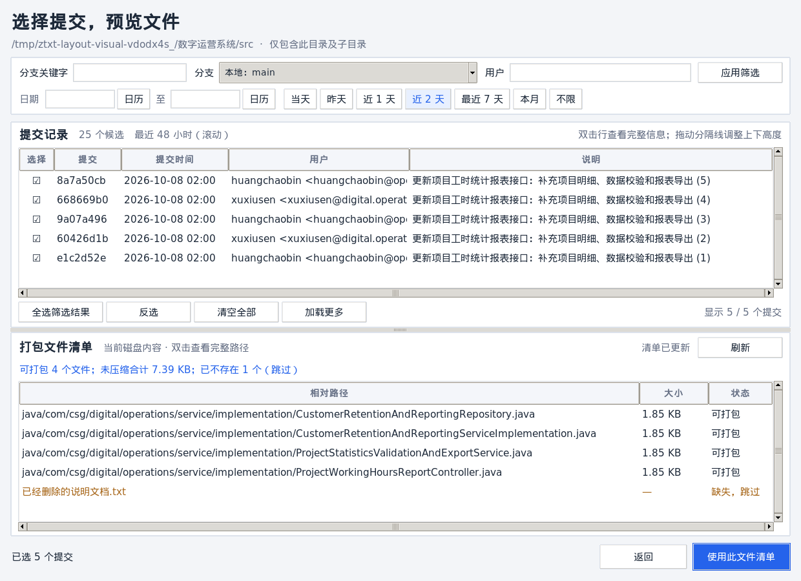

# ZIP 文本归档

把文件或目录压缩为 ZIP，用密码加密，再转换为按序编号的 Base64 文本分片。收齐分片后，可在 Windows、macOS 或 Linux 上用本程序还原。分片是加密文本，不能直接交给普通 ZIP 解压软件打开。

## 下载图形版

**v0.4.1**：Git 提交与文件清单改为上下排列，可拖动分隔线调整高度；长信息可查看、复制全文，并新增最近 24／48 小时筛选。保留浅色侧栏、独立用户列、各阶段真实字节进度、密码显隐、复制路径和设置记忆。

该版本的发布页为 [ZipToTxt v0.4.1](https://github.com/iyanghong/ZipToTxt/releases/tag/v0.4.1)，下载地址如下：

| 系统 | 程序 | 运行方法 |
| --- | --- | --- |
| Windows x64 | [ZIP 包](https://github.com/iyanghong/ZipToTxt/releases/download/v0.4.1/zip-to-txt-windows-x86_64.zip) · [独立 EXE](https://github.com/iyanghong/ZipToTxt/releases/download/v0.4.1/ZipToTxt.exe) | 解压 ZIP 后双击 `ZipToTxt.exe`，或直接运行独立 EXE。 |
| macOS Apple 芯片 | [ZIP 包](https://github.com/iyanghong/ZipToTxt/releases/download/v0.4.1/zip-to-txt-macos-arm64.zip) | 解压后打开 `ZipToTxt.app`。 |
| Linux x64 | [tar.gz 包](https://github.com/iyanghong/ZipToTxt/releases/download/v0.4.1/zip-to-txt-linux-x86_64.tar.gz) | 解压后运行 `./zip-to-txt-gui`。 |

这些程序已包含 Python、Tkinter 和加密依赖，目标机器无需安装 Python。Linux 版在 Ubuntu 22.04 构建，需要兼容的图形桌面和系统库。macOS 版仅做本地临时签名，Windows 版未签名；系统首次打开时可能要求手动允许运行。Windows 版由 Wine 构建，尚未在原生 Windows 上完成运行测试。

[SHA-256 校验值](https://github.com/iyanghong/ZipToTxt/releases/download/v0.4.1/SHA256SUMS) 覆盖三个平台的压缩包和独立 Windows EXE。将四个文件放在同一目录，使用 `shasum -a 256 -c SHA256SUMS` 校验（Linux 也可使用 `sha256sum -c SHA256SUMS`）。

本地产物保存在 `release/v0.4.1/`，`release/` 被 Git 忽略；二进制包通过 GitHub Releases 分发。详见[发布说明](docs/releases/v0.4.1.md)、[本次测试记录](docs/test-results-git-layout-2026-10-08.md)；历史版本可在 [Releases](https://github.com/iyanghong/ZipToTxt/releases) 查找。

## 图形界面使用


### 压缩并加密

1. 选择“压缩并加密”，再选择一个文件或目录。
2. “每个 TXT 上限”默认是 **50 MB**；可改为 **1～200 MB 的整数**。这里的 MB 按 1,000,000 字节计算，限制的是生成的 TXT 文件大小。
3. 输入密码并再次确认，可通过“显示／隐藏”查看输入；点击“压缩并加密”。完成后，结果直接显示在窗口中，可打开输出目录或复制路径。处理中表单禁用，界面仍保持响应。

### 按 Git 提交打包当前文件

选择 Git 工作树内的目录后，可点击“按 Git 提交选择”。功能使用系统已安装、能从 `PATH` 找到的 Git；没有 Git、目录不在 Git 工作树中或仓库尚无提交时，按钮禁用，普通压缩仍可使用。手动输入目录路径也会触发检测。

1. 默认查看当前分支，可改选本地分支或本机已有的远程跟踪分支，例如 `origin/main`。“分支关键字”按分支名不区分大小写做包含匹配，同时过滤本地及远程候选；搜索文字不改变当前分支或已选提交。程序只读本地历史，不切换实际工作分支，也不自动联网拉取。
2. 点击起止日期框或“日历”可选择日期，也可直接手输 `YYYY-MM-DD`；再次点击“日历”、点击日历中的“关闭”或在输入框按 Esc 可收起日历。手输日期或作者后点击“应用筛选”。快捷项会直接应用：**近 1 天／近 2 天为最近 24／48 小时**，以每次查询时刻计算，列表上方显示当前时间范围；继续筛选分支或用户时保留此模式。输入日期、选日历日期或点击其他快捷项会切回自然日范围。“当天、昨天、最近 7 天、本月、不限”沿用本机时区：最近 7 天包含今天，本月为月初到月末，不限清空日期和最近时间模式。日期均按提交时间筛选；用户按作者姓名或邮箱进行不区分大小写的包含匹配。“用户”列独立显示作者姓名及邮箱。
3. 点击每行“选择”列的勾选框选中提交；在行上按空格也可切换。“全选筛选结果”和“反选”覆盖所有匹配提交，包括尚未显示的行；其他筛选范围内已保留的选择不受影响。“清空全部”清除所有选择。列表每次显示 200 条，可“加载更多”。实际更换分支会清空选择；调整日期或作者仍保留列表外选择，并显示数量。
4. **上方勾选提交，下方自动预览文件**；可拖动两表之间的分隔线调整高度。清单显示去重路径、未压缩大小、数量和缺失项。双击行或选中后按 Enter，可查看并复制完整提交信息或文件路径；提交时间列按当前字体测量宽度。窗口较小时快捷筛选自动换行，大字体下自动提高最小窗口高度以保留完整数据行。可连续修改勾选，旧结果不会覆盖新选择；清单未就绪或没有可打包文件时，确认按钮禁用。无需填写密码即可预览，也可点击“刷新”重新检查磁盘。
5. 点击“使用此文件清单”返回主界面，设置密码和输出位置，再点击“压缩并加密”。程序重新检查文件范围和缺失状态：未变化则直接开始；发生变化才显示最新清单，确认后开始加密打包。仅文件内容变化不会重复确认，归档读取打包时的当前磁盘内容。重新打开“修改 Git 提交”可继续使用此前的筛选和勾选。



提交只决定文件路径范围：所有所选提交的变更路径合并去重后，读取当前磁盘上的文件内容。因此，后来未勾选提交的改动以及尚未提交的修改也可能进入归档；未出现在所选提交路径清单中的未跟踪文件不会进入包。只包含所选目录及其子目录，还原后保留所选目录的顶层名称。

初始提交包含其新增路径，合并提交与第一父提交比较，重命名记录旧、新两条路径。当前已不存在的路径列明并跳过；删除清单不作为删除指令执行。符号链接、子模块目录、特殊文件和跨平台名称冲突仍会拒绝；预览后文件消失或读取失败会报错，避免输出不完整的包。可点击“完整目录”返回普通模式。数字菜单 CLI 继续提供原有完整文件或目录归档。

### 解密并还原

1. 将同一套 `part-000001.txt`、`part-000002.txt` 等文件放在一个目录中，不要混入其他 TXT，也不要改名或漏片。
2. 选择侧栏“解密并还原”，选择分片所在目录，输入压缩时的密码，点击“解密并还原”。无需填写原先设置的分片大小。
3. 完成后，在界面显示的输出目录中查找原始文件或目录。

两种操作都可以在“输出位置”中选择一个**已存在的目录**；留空则使用默认位置：

| 操作 | 留空时 | 指定输出位置 `D` 时 |
| --- | --- | --- |
| 压缩 | 在源文件或目录旁新建 `<原名称>.txtparts` | 在 `D` 下新建 `<原名称>.txtparts` |
| 还原 | 在分片目录内新建 `restored` | 在 `D` 下新建 `restored` |

例如压缩 `C:\work\资料`，默认得到 `C:\work\资料.txtparts`；还原这个分片目录，默认得到 `C:\work\资料.txtparts\restored\资料`。目标输出目录已存在时程序会报错，不会覆盖。

密码丢失、分片缺失或内容损坏时无法还原。单片上限设置得越大，处理时需要的内存越多。超过 50 MB 的分片须使用当前版本还原；旧版程序仍按 50 MB 拒绝。当前版本兼容 TXT 末尾意外附加的单个空字节（NUL），其余非法内容仍会报错。

### 进度与设置记忆

进度条按阶段分别显示百分比和“已处理／总大小”，切换阶段后重新计数：

| 阶段 | 统计依据 |
| --- | --- |
| 压缩文件 | 实际读取并写入 ZIP 的原文件字节 |
| 加密生成 TXT | 已完成加密并写出分片的 ZIP 字节 |
| 校验解密 TXT | 已成功校验、解密并写入 ZIP 的 TXT 字节 |
| 解压文件 | 实际解压并写出的原文件字节 |

扫描文件及获取总量时显示忙碌状态；零字节文件和空目录也可正常完成。加密和解密以一个分片完成为更新点，单片处理期间百分比可能暂时保持不变。进度为各阶段真实处理量，没有按时间推进或估算全流程百分比。

程序记住文件选择对话框的上次目录、输出位置和分片大小，密码与确认密码不会保存，任务结束后清空。偏好文件在当前用户目录：

- Windows：`%APPDATA%\ZipToTxt\settings.json`。
- macOS：`~/Library/Application Support/ZipToTxt/settings.json`。
- Linux：`$XDG_CONFIG_HOME/zip-to-txt/settings.json`；未设置时使用 `~/.config/zip-to-txt/settings.json`。

配置缺失或损坏时采用默认值；失效的目录不会回填。删除此文件可重置记忆。窗口较小时参数卡片改为上下排列，表单可滚动，开始按钮和状态区域仍可访问。

## 从源码运行

需要 Python 3.10 或更新版本。先安装加密依赖：

```sh
python -m pip install cryptography
```

运行数字菜单命令行版：

```sh
python zip_to_txt.py "待处理路径"
python zip_to_txt.py "待处理路径" --part-size-mb 20 --output-dir "已有的输出目录"
```

启动后输入 `1` 压缩并加密，或输入 `2` 解密并解压缩。路径参数可省略，随后在菜单中输入。`--part-size-mb` 只用于压缩，默认 50；Windows 可把命令中的 `python` 换为 `py -3`。密码通过终端提示输入。

运行源码图形版还需 Python 支持 Tkinter：

```sh
python zip_to_txt_gui.py
```

可先用 `python -m tkinter` 检查 Tkinter。输入中的符号链接、跨平台禁用文件名以及同目录下仅大小写不同的名称会被拒绝。

运行归档与 Git 功能测试：

```sh
python test_zip_to_txt.py
python test_git_archive.py
python test_git_archive.py --gui  # 需要 Tkinter 和可用的图形桌面
python test_gui_controls.py      # 日期与文件预览控件测试，不依赖 Git
python test_ui_redesign.py       # 真实进度、侧栏、密码显隐、设置和错误清理
```

## 自行构建图形版

在构建机器上安装带 Tkinter 的 Python，以及 `cryptography` 和 `pyinstaller`：

```sh
python -m pip install cryptography pyinstaller
```

分别在目标系统与架构上构建：

```sh
# Windows：dist/ZipToTxt.exe
python -m PyInstaller --onefile --windowed --name ZipToTxt zip_to_txt_gui.py

# macOS：dist/ZipToTxt.app
python -m PyInstaller --onedir --windowed --name ZipToTxt zip_to_txt_gui.py

# Linux：dist/ZipToTxt
python -m PyInstaller --onefile --name ZipToTxt zip_to_txt_gui.py
```

如需单独打包命令行版，在对应系统运行 `python -m PyInstaller --onefile --console --name zip-to-txt zip_to_txt.py`。

Windows 图形版在 Wine 9 中以桌面启动方式通过主窗口检查；从 Linux 后台 shell 启动时出现 Wine 标准流的无效句柄错误，详见[本次测试记录](docs/test-results-ui-2026-10-08.md)。Wine 检查不能替代原生 Windows 验证。

可使用与构建时**相同 Python 版本**的测试环境和对应版本源码，读取并执行产物内的实际应用代码，再运行回归测试（仍需要测试环境安装 PyInstaller、加密依赖、Tkinter 和系统 Git）：

```sh
python packaging/test_bundle.py "可执行文件路径" test_ui_redesign.py test_gui_controls.py test_git_picker_layout.py test_git_archive.py test_zip_to_txt.py
python packaging/test_compatibility.py "当前可执行文件路径" "v0.3.0 可执行文件路径"
```

该检查验证包内应用代码；冻结程序的启动器和附带运行库还应单独进行实际启动检查。

仓库的 `packaging/Dockerfile.linux` 可用于 Linux x64 构建，`packaging/Dockerfile.windows-wine` 可用于 Wine 交叉构建 Windows x64 程序。各平台产物不能互换；Windows 构建仍需在原生 Windows 上验证。[完整测试记录](docs/test-results-2026-10-01.md)。
