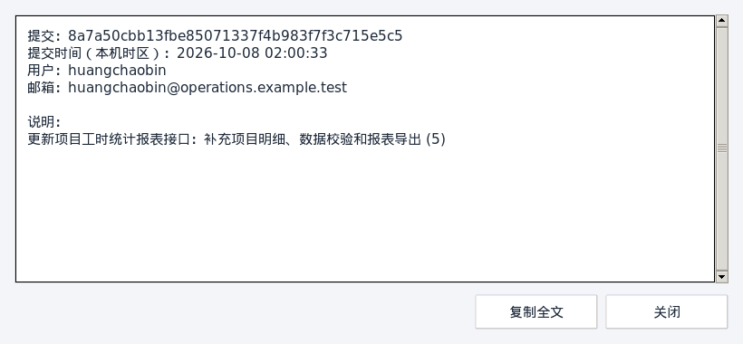
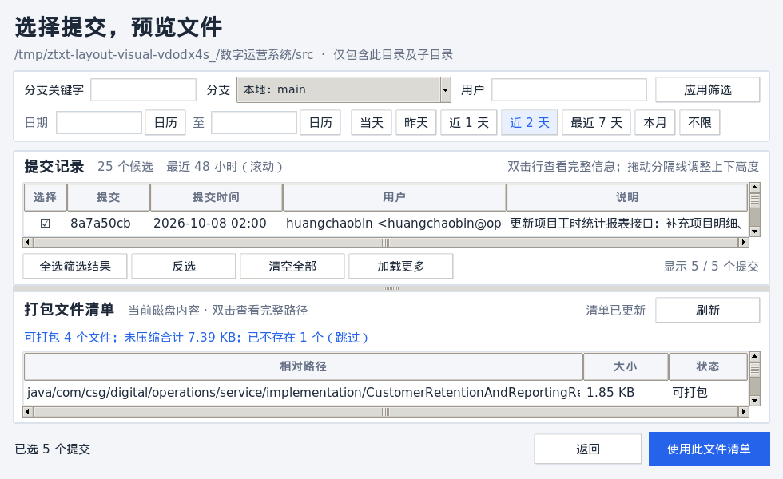

# v0.4.1 Git 窗口布局与时间筛选测试记录

2026-10-08 完成上下列表、完整信息查看和最近 24／48 小时筛选。三个本地发布包位于 `release/v0.4.1/`；当日仅完成本地打包。

## 环境与结果

| 平台 | 环境 | 已通过 |
| --- | --- | --- |
| macOS arm64 | macOS 26.5.2；Python 3.14.7、Tk 9.0.4、cryptography 46.0.5、PyInstaller 6.22.3 | 五组包内回归、真实 Git 与 Tk、旧版双向还原、独立 `.app` 启动、签名及解包检查 |
| Linux x86_64 | Ubuntu 22.04、glibc 2.35；Python 3.10.12、Tk 8.6、cryptography 50.0.1、PyInstaller 6.22.3；Docker x64 仿真、Xvfb | 五组包内回归、真实 Git 与 Tk、旧版双向还原、独立程序启动、中文界面截图及解包检查 |
| Windows x86_64 | Windows Python 3.13.15、Tk 8.6、cryptography 50.0.1、PyInstaller 6.22.3；Wine 9、Xvfb | 四组包内回归、固定提交数据的筛选与真实 Tk、旧版双向还原、独立 EXE 可见窗口及解包检查 |

使用与构建时相同的 Python，读取最终可执行文件中的 GUI、Git 和归档模块运行测试；加载时逐一比较包内代码与当前源码编译结果，防止测试到旧包。另行启动各系统的冻结程序，检查启动器与附带运行库。构建环境及启动方式沿用 [v0.4.0 测试记录](test-results-ui-2026-10-08.md)。

Windows 测试环境未安装 Git：其新布局测试使用固定 Git 日志数据，实际执行包内时间筛选、真实磁盘文件检查、Tk 控件及剪贴板操作。真实 Git 子进程和完整提交打包流程在 macOS、Linux 验证，不能把 Windows 的固定数据测试视为原生 Git 集成验收。

## 复现与修正

修改前用真实临时仓库、长 Java 路径、长作者邮箱和中文说明复现：1240 像素窗口中，提交表宽 754 像素，文件表宽 358 像素。左右分栏使表格列和路径缺少空间；固定时间列还会受字体宽度影响。

改为顶部筛选、上方提交、下方文件清单，保留可拖动分隔线；时间等固定列按字体测量宽度。长信息提供只读详情窗口，可选中文本并复制全文。文件统计改为一行，筛选区在宽度不足时换行。

连续包内测试还发现，窗口缩小及字体缩放后默认分隔线可能留下不完整的提交行。现在按控件请求尺寸计算至少一行所需高度，限制分隔线；字体需要更多空间时自动提高最小窗口高度。测试覆盖从默认大窗口直接缩小、未勾选及已选状态，避免只检查宽度。

## 新增检查

- 真实 Git 创建七条提交：当前时刻、未来一秒、24／48 小时窗口起点、起点前一秒，以及昨天但仍在最近 24 小时中的提交。窗口起点包含，未来提交排除；与当天自然日范围区分。查询时刻推进后，结果随滚动窗口更新。
- 实际点击近 1 天、近 2 天按钮，核对返回提交；按用户继续筛选时保留滚动模式。输入日期、点击不限切回自然日模式，确认后重新打开回填最近时间和已选提交。
- 长作者、邮箱、说明和相对路径在详情中完整可读。实际按 Enter 打开提交详情、双击打开文件详情，并从系统剪贴板读回复制结果核对全文。
- 默认窗口、980×600 请求尺寸和 Tk 字体缩放 2.0 下，检查列表占满有效宽度、上下位置、完整数据行及文件状态列。大字体下允许窗口自动抬高最小高度；在较大窗口验证分隔线可调整。
- 原有真实 Git 回归继续覆盖目录范围、分支过滤、日历与自然日筛选、205 次提交的全选／反选及加载更多、异步预览、过期结果丢弃、缺失项、选择回填和当前磁盘内容归档。

## 归档与运行回归

三个平台均运行包内主界面／真实进度、日期／文件预览、归档往返及错误处理测试；macOS、Linux 还运行真实 Git 集成测试。每个平台分别由 v0.3.0 生成分片交给新版还原，再由新版生成分片交给 v0.3.0 还原，两方向均通过。

此次未修改加密容器及核心归档格式。跨平台九组互通结果见 v0.4.0 记录，本次没有重新声称执行该九组矩阵。

独立 Windows EXE 以桌面方式启动，检查主窗口确实可见且没有启动错误弹窗；macOS `.app` 和 Linux 冻结程序独立启动并存活六秒。Linux 同时捕获实际冻结主窗口，Git 截图由最终包内代码创建，查询真实临时仓库。

## 实际界面

以下截图来自 Xvfb，使用中文字体、25 个本地分支、5 条长说明提交、4 个长路径文件和 1 个缺失项，非 HTML 预览。时间按该测试环境的本机时区显示。






## 发布包校验

- Windows ZIP 仅含 `ZipToTxt.exe` 与 `README.txt`；macOS ZIP 含 `.app` 与说明；Linux TAR 含可执行文件与说明，不含测试日志或构建缓存。
- 实际解包核对可执行文件 SHA-256；两个 ZIP 的 CRC、Linux 执行权限、macOS 解包后的临时签名验证均通过。
- `SHA256SUMS` 中三个发布包与 Windows EXE 共四项逐一核对通过。文件类型分别为 PE32+ GUI x86-64、Mach-O arm64、ELF x86-64。
- 日志及截图原始数据保存在 `release/v0.4.1/test-logs/`，发布目录继续被 Git 忽略。

2026-10-09 发布前复核：再次执行四项 SHA-256 校验，全部通过；重新加载 macOS 最终产物，确认其中 GUI、Git 和归档模块与当前源码一致。本次整理发布文档未修改程序代码，沿用上述已经测试的三个平台产物。发布用 `SHA256SUMS` 将独立 EXE 文件名写为 `ZipToTxt.exe`，与 Release 下载后的文件名一致。

## 执行入口

```sh
python test_git_picker_layout.py
python test_git_archive.py --gui
python packaging/test_bundle.py "最终可执行文件" test_ui_redesign.py test_gui_controls.py test_git_picker_layout.py test_git_archive.py test_zip_to_txt.py
python packaging/test_compatibility.py "v0.4.1 可执行文件" "v0.3.0 可执行文件"
shasum -a 256 -c SHA256SUMS
git diff --check
```

无系统 Git 的环境中，布局测试会明确输出固定数据模式；Windows 包内测试不包含 `test_git_archive.py`。

## 验证边界

未在原生 Windows 或真实 Linux 桌面做人工点击验收；Wine／Xvfb 和 Tk 字体缩放检查不能替代目标机器的 DPI、系统字体及窗口管理器验收。macOS 真实 Tk 和 `.app` 启动通过，本次仍未取得本机屏幕截图。macOS 包为 Apple 芯片 arm64，Linux 需要兼容的图形桌面与系统库。
