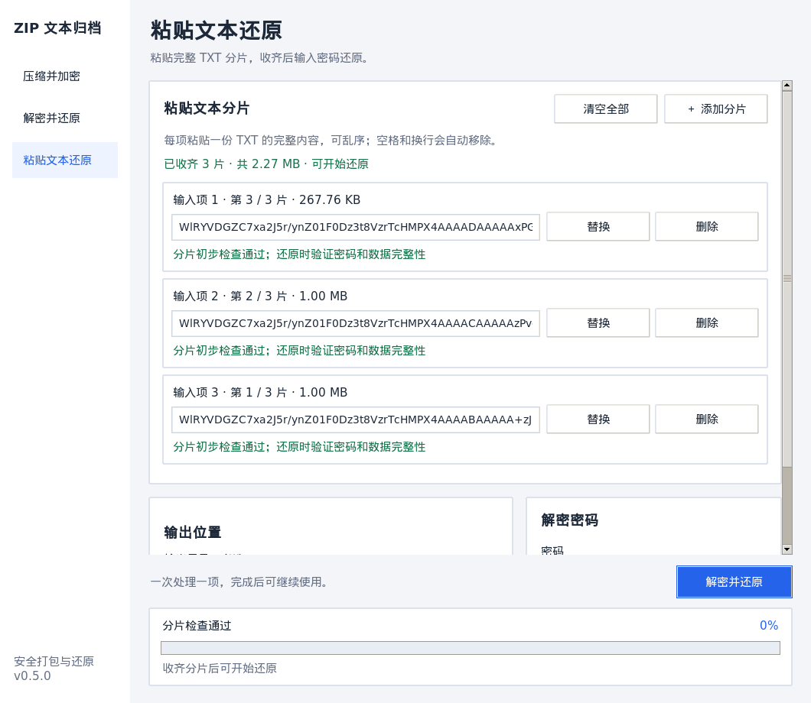

# v0.5.0 粘贴文本还原与大文本响应测试

2026-10-10 完成新增页面、分片暂存及后台还原。三个发布包的本地产物保存在 `release/v0.5.0/`，下载及运行条件见[发布说明](releases/v0.5.0.md)。

## 环境

| 平台 | 测试环境 |
| --- | --- |
| macOS arm64 | 原生 macOS 26.5.2；Python 3.14.7、Tk 9.0.4、cryptography 46.0.5、PyInstaller 6.22.3 |
| Windows x86_64 | Wine 9、Xvfb；Windows Python 3.13.15、Tk 8.6、cryptography 50.0.1、PyInstaller 6.22.3 |
| Linux x86_64 | Ubuntu 22.04、glibc 2.35、Docker x64 仿真、Xvfb；Python 3.10.12、Tk 8.6、cryptography 50.0.1、PyInstaller 6.22.3 |

宿主为 Apple 芯片 Mac，24 GB 内存。Docker／Wine 的耗时包含仿真和冻结进程启动成本。

## 真实剪贴板和多片大文本

每个平台独立生成 **260,000,000 字节**随机原文件，压缩并加密为三份完整 TXT：**120,000,000、120,000,000、106,772,824 字节**，合计 **346.77 MB**。测试从系统剪贴板倒序粘贴三片，前两片保留期间继续粘贴第三片，再实际解密、解压，并逐字节计算原文件与还原文件的 SHA-256；三个环境均一致。

测试加载最终产物中的 GUI、Git、归档和粘贴模块，逐一比较包内代码与源码编译结果，在同版本 Python／Tk 中创建真实 `App` 窗口。工作进程的启动目标设置为最终 `.app` 主程序、Windows EXE 或 Linux ELF，确保读取剪贴板及还原确实执行产物内代码。另行检查最终主程序启动。没有用模拟剪贴板或假进度代替上述操作。

数据生成和剪贴板提供者位于外部进程，避免把生成归档的内存算入 GUI。macOS 测试通过 `pbcopy`／`pbpaste` 使用系统剪贴板，结束后恢复原有纯文本内容；Windows 使用实际 `CF_UNICODETEXT`，Linux 使用独立 Xvfb 中的 Tk 剪贴板。

## 响应与内存

窗口以 20 ms 定时回调记录实际间隔，覆盖三次粘贴、错误密码重试和解密解压，包括每项完成后的最后一个间隔。本环境验收上限为 **250 ms**；不是只检查定时回调曾经运行。

| 平台 | 所有阶段的最大回调间隔 | 粘贴后 GUI 常驻内存的最大增量 | 结果 |
| --- | --- | --- | --- |
| macOS arm64 | 30.1 ms | 4.41 MB | 通过 |
| Windows x86_64（Wine） | 118.4 ms | 1.28 MB | 通过 |
| Linux x86_64（Xvfb） | 42.8 ms | 0.64 MB | 通过 |

内存数据为开始及每次粘贴后的采样，增量相对开始计算；不是全流程峰值，也不包含系统剪贴板和后台进程。完整文本没有在 GUI 中按片累积，界面只保留短预览及元数据。Linux 的 Tk 剪贴板读取仍可能在后台进程中持有整片文本，因此不能把上述 GUI 增量理解为程序总内存用量。

| 平台 | 第 1 项（106.77 MB） | 第 2 项（120 MB） | 第 3 项（120 MB） | 解密及解压 |
| --- | --- | --- | --- | --- |
| macOS arm64 | 1.80 s | 0.45 s | 0.46 s | 1.44 s |
| Windows x86_64（Wine） | 2.46 s | 2.73 s | 2.63 s | 4.35 s |
| Linux x86_64（Xvfb） | 11.65 s | 11.39 s | 11.01 s | 3.42 s |

这些是完整读取、检查或还原所需时间；操作尚未完成时窗口继续处理事件。结果只对应本次环境与数据，不保证所有机器均达到相同耗时或间隔。

原文件和还原文件共同的 SHA-256：

- macOS arm64：`3028d0ad94f8e26cf6c0ee5961dd883cc3f58e386dbdc39a0a3c97b02a6b05a6`。
- Windows x86_64（Wine）：`8663d4318e5da6c4cd098b96269cf1edbe48cec927c17534afce4a9636dfc134`。
- Linux x86_64（Xvfb）：`f16e62ce4614b22e23fa29c8cc22acd97219c689a87bc34608a9470c4148bfe5`。

### 测试发现并修正的卡顿

第一轮 Windows／Wine 大文本测试测到约 **0.75 秒**的界面回调间隔，超过验收上限。原因是虽然读取和还原已移到独立进程，`Process.start()` 仍在主线程执行。将启动移至后台线程后重建三个平台产物，再验证实际冻结工作进程；Windows 最大间隔降至约 **118 ms**，验收通过。决策见 [ADR 0003](adr/0003-background-processes-for-pasted-parts.md)。

## 功能与错误处理

- 真实控件增加、粘贴、替换及删除；预览长度始终小于 120 字符；空项不算分片。
- 多片倒序粘贴，按头部序号自动还原；缺片、重复、不同归档的检查。
- 分块移除空格、制表符、CR／LF；兼容一个末尾 NUL；拒绝说明文字、非法字符、截断、拼接两片和多个 NUL。
- 200 MB 规范化文本上限的拒绝分支，以及已有暂存文件不覆盖、不删除；边界测试将上限缩小到测试片大小附近，未伪称实际生成超过 200 MB 的分片。
- 从真实剪贴板替换为非法文本后保留原分片并阻止开始；重新粘贴正确片后删除旧缓存，恢复可还原状态。
- 实际粘贴重复片阻止开始，删除重复片恢复；切换页面保留已粘贴内容。
- 错误密码保留全部分片且无输出目录，改用正确密码成功还原；成功清空分片和暂存目录，显示 100%，清空密码。
- 设置文件不保存密码；关闭清理私有暂存目录。

本次改造也通过原有归档、进度、设置、日期和 Git 控件回归。macOS、Linux 各运行五组既有测试，包含真实 Git 仓库；Windows 运行四组，Git 窗口使用固定提交数据，未安装系统 Git。Linux 在最后的后台启动调整后重新执行新功能全套、大文本与冻结程序启动检查，其余未受影响的回归沿用本次已通过结果。没有声称重新执行旧版九组跨平台互通矩阵。

## 实际界面

截图来自最终 Linux 包内代码创建的 Tk 窗口，使用三份小体积真实 TXT 分片和系统剪贴板完成粘贴，展示乱序片号、摘要及完整性提示；性能数据来自上面的三份超过 100 MB 的分片。



## 产物与校验

- Windows ZIP 仅包含 `ZipToTxt.exe` 和 `README.txt`；macOS ZIP 包含 `.app` 与说明；Linux TAR 包含程序和说明，不含测试日志或构建缓存。
- 两个 ZIP 的 CRC、解包后程序 SHA-256、Linux 执行权限、macOS 解包后的临时签名均通过。
- `SHA256SUMS` 中三个压缩包和独立 Windows EXE 的四项逐一核对通过。
- macOS `.app` 与 Linux ELF 独立启动并存活六秒；Windows EXE 以桌面方式启动并检查可见窗口。
- 原始大文本测量 JSON 保存在 `release/v0.5.0/test-logs/`，日志在对应平台目录或版本根目录；发布目录继续被 Git 忽略。

## 复现入口

需要图形桌面。大文本测试会临时占用剪贴板、磁盘和后台进程内存：

```sh
python test_paste_restore.py --large
ZTXT_PASTE_LARGE=1 python packaging/test_bundle.py "最终可执行文件" --frozen-workers test_paste_restore.py
python packaging/test_bundle.py "最终可执行文件" test_ui_redesign.py test_gui_controls.py test_git_picker_layout.py test_git_archive.py test_zip_to_txt.py
shasum -a 256 -c SHA256SUMS
git diff --check
```

Windows 可在 PowerShell 先设置 `$env:ZTXT_PASTE_LARGE = "1"`，再运行冻结工作进程测试。测试环境需使用与产物相同的 Python 版本，并安装构建依赖。无系统 Git 时省略真实 Git 集成测试。

## 验证边界

未在原生 Windows 或真实 Linux 桌面完成大文本人工验收。Wine／Xvfb 不覆盖所有 DPI、系统字体、窗口管理器及 Wayland 剪贴板行为。macOS 包为 arm64，Linux 包需要兼容的图形桌面与系统库；单片规范化文本上限仍是 200 MB。
