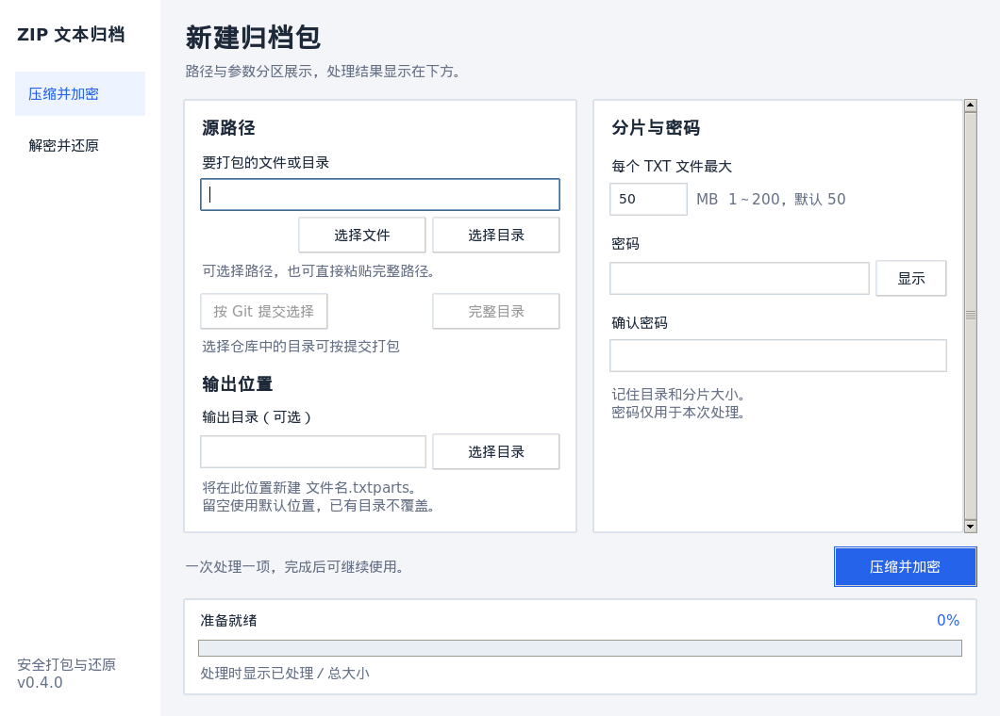
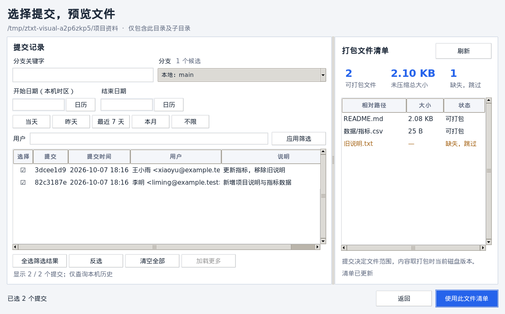

# v0.4.0 界面与真实进度测试记录

测试对象为 B 侧栏工作区、各阶段真实字节进度、合并的 Git 提交及文件预览窗口、独立用户列、密码显隐、路径复制和非密码设置记忆。三平台发布包位于 `release/v0.4.0/`；本次只构建本地产物，未发布到 GitHub Releases。

## 环境与范围

| 平台 | 构建／测试环境 | 验证方式 |
| --- | --- | --- |
| macOS arm64 | macOS 26.5.2；Python 3.14.7、Tcl/Tk 9.0.4、cryptography 46.0.5、PyInstaller 6.22.3 | 包内实际应用代码的四组测试、与 v0.3.0 双向还原、实际 `.app` 启动及临时签名验证 |
| Linux x86_64 | Ubuntu 22.04、glibc 2.35；Python 3.10.12、Tcl/Tk 8.6、cryptography 50.0.1、PyInstaller 6.22.3；Docker x64 仿真、Xvfb | 包内四组测试、与 v0.3.0 双向还原、实际冻结程序启动及界面截图 |
| Windows x86_64 | Windows Python 3.13.15、Tcl/Tk 8.6、cryptography 50.0.1、PyInstaller 6.22.3；Wine 9、Xvfb | 包内进度／主窗口、日期／预览控件、归档三组测试；与 v0.3.0 双向还原；独立 EXE 的可见主窗口及启动错误检查 |

包内检查通过 PyInstaller 归档读取器加载最终产物中的 GUI、归档与 Git 模块，测试环境提供对应版本的 Python 和依赖。加载时还会比较产物代码与当前源码编译结果，防止遗漏重新构建。它验证实际打包的应用代码；各平台另行启动冻结程序，检查启动器和附带运行库。Windows 测试环境未安装 Git，因此真实 Git 子进程与完整提交勾选流程在 macOS 和 Linux 验证。

## 真实进度与归档

- 使用 5,500,000 字节的随机文件、多片归档、零字节文件和空目录，核对四个阶段的起点、单调字节计数、中间进度、完成值和实际总量。加密总量与容器中 ZIP 数据长度一致，解密总量与实际 TXT 大小一致。
- ZIP 压缩和文件解压以 1 MiB 读写块回传；加密／解密在一个分片成功写出后更新。扫描无总量时显示忙碌状态，阶段百分比独立计算。
- 实际主窗口处理 20 MiB 随机文件，捕获真实中间百分比和“已处理／总大小”；任务期间输入禁用，Tk 定时回调继续执行。成功内联显示结果，不弹成功窗口，复制路径可从真实剪贴板读回。
- 错误密码没有成功进度或残留输出。额外构造认证有效但 ZIP CRC 损坏的分片，确认解压过程中出现真实字节进度后仍报错，并清理已产生的部分输出。
- 回归覆盖默认 50 MB、100 MB 大片、1／200 MB 边界和非法大小；指定输出位置、拒绝覆盖、损坏／缺失／重复片、单个末尾 NUL 兼容、中文路径与文件内容 SHA-256 一致。
- 分别加载各平台 v0.3.0 与 v0.4.0 的真实产物，旧版写入新版还原、新版写入旧版还原均通过；多片、中文文件、空目录的格式继续兼容。

- 使用 `packaging/test_platform_exchange.py`，macOS、Linux、Windows 分别生成 1 MB 多片归档，再在三个平台分别还原，九组互通全部通过。逐项核对文件范围、SHA-256、零字节文件和空目录，包含 Windows 写入后由 macOS 读取的路径。

## 主窗口与设置

- 首次启动检查路径表单确实可见；860×600 主窗口纵向排列卡片并可滚动，1060×760 恢复左右分栏，开始按钮可访问；980×600 的 Git 窗口仍能显示完整提交行。
- 侧栏操作状态、还原时隐藏分片大小及确认密码、密码显隐、复制路径和打开目录按钮状态均通过真实控件调用检查。
- 偏好只包含源目录、输出目录和整数分片大小；密码及确认密码不写入 JSON。任务结束后清空并隐藏密码，损坏配置恢复默认值。
- 配置路径使用各平台用户配置目录；测试使用独立临时设置文件，避免更改使用者的偏好。

## Git 合并窗口

- 提交列表独立“用户”列显示作者姓名和邮箱；原分支关键字、日期日历／快捷项、用户筛选、逐行勾选、全选／反选和分页继续通过。
- 真实临时仓库生成 205 次修改提交，全选包含尚未显示的 5 条提交，加载更多与反选不会丢失选择。
- 为真实查询／预览加入延迟后，Tk 定时回调继续运行，清单计算时仍可修改勾选。连续取消和改选提交后，旧结果不会覆盖最新文件清单；未就绪时不能确认。
- 自动预览展示去重路径、数量、原始大小和缺失项，确认后回到主窗口；重新打开保留筛选和勾选。全部文件缺失时不能确认空包。
- 开始打包前删除文件，会弹出更新后的清单；取消不生成输出。只改变文件内容时直接打包，实际还原内容为当前磁盘版本。
- 保留目录范围、合并、重命名、删除、符号链接／子模块／名称冲突检查。系统无 Git 时提交功能禁用，普通压缩仍能实际完成并还原。

## 测试中修正的问题

1. 自动隐藏表单滚动条会使部分 Tk 8.6 首次启动时画布未映射，出现空白表单。保留滚动条，并加入首次启动可见性检查；实际冻结程序截图再次核对。
2. 关闭测试窗口后，后台闭包持有界面对象可能在工作线程释放 Tk 变量。后台工作改为只持有普通路径、队列和参数；关闭时解除变量追踪。测试使用 `update()` 驱动多根窗口，测试期间在主线程显式回收，避免工作线程回收旧窗口；实际程序使用单根窗口的 `mainloop()`。
3. 中文字体下，Git 筛选区高度会挤掉提交行。压缩筛选留白、将用户筛选放到单行、使用紧凑控件；新增小窗口完整提交行检查。文件表根据可用宽度调整路径列，确保默认窗口可看到完整状态列；说明文字随右侧宽度换行。Git 测试显示父窗口，避免仅检查未映射的控件数据。
4. Wine 缓存镜像残留显示 99 的锁，Xvfb 未实际启动，造成窗口不可见。改用新的显示会话；启动检查增加可见性要求，避免仅凭窗口标题判定成功。构建使用 `pythonw.exe` 并在初始化后写日志，绕开 Wine 后台标准流句柄问题；未修改应用的加密或平台行为。

## 执行入口

```sh
python test_ui_redesign.py
python test_gui_controls.py
python test_git_archive.py --gui
python test_zip_to_txt.py
python packaging/test_bundle.py "最终可执行文件" test_ui_redesign.py test_gui_controls.py test_git_archive.py test_zip_to_txt.py
python packaging/test_compatibility.py "v0.4.0 可执行文件" "v0.3.0 可执行文件"
git diff --check
```

实际冻结程序分别独立启动。Windows 先以桌面方式启动 EXE，再运行 `packaging/test_frozen_windows.py`，等待可见主窗口，并检查启动错误弹窗。

## 界面截图

Linux 截图来自 Xvfb 中的实际冻结主窗口；Git 窗口由最终包内代码创建，并使用真实临时 Git 仓库查询及计算文件清单。测试环境使用中文字体，截图不是 HTML 预览。





## 发布包检查

三个发布包包含各平台程序和 `README.txt`，不包含测试日志、临时数据或构建缓存。实际解包并核对可执行文件 SHA-256；ZIP 的 CRC、Linux 执行权限和 macOS 解包后的临时签名均通过。`SHA256SUMS` 覆盖三个压缩包与 Windows EXE。文件类型为 PE32+ GUI x86-64、Mach-O arm64 和 ELF x86-64；`release/` 被 Git 忽略。

## 验证边界

未在原生 Windows 或真实 Linux 桌面完成手工点击验收；Windows 中未执行真实 Git 查询。macOS 的真实 Tk 控件测试及 `.app` 启动通过，但因屏幕捕获权限状态未取得本机截图。Wine／Xvfb 检查不能替代每个目标系统的人工验收。

macOS 包是 arm64，不包含 Intel 版本；Linux 包需要兼容的图形桌面及系统库。三个系统的可执行文件不能互换。
